# AI Resume Screening & Interview Bot with Personalized Interview Generation

[](https://www.python.org/)
[](https://fastapi.tiangolo.com/)
[](https://reactjs.org/)
[](https://www.reportlab.com/)
[](https://www.mongodb.com/)
[](https://www.trychroma.com/)
[](https://ai.google.dev/)
[](https://www.docker.com/)

An end-to-end AI-powered recruitment platform designed to automate resume screening, multi-factor ATS matching, personalized interview generation, live interview execution with AI proctoring, real-time answer evaluation, adaptive questioning, candidate scoring consolidation, PDF assessment report generation, and containerized production deployment.

---

## 🚀 System Architecture & Module Pipeline

```mermaid
flowchart TD
    subgraph Candidate Workflow
        A[Candidate Register / Login] --> B[Upload PDF/DOCX Resume]
        B --> C[Browse Active Jobs]
        C --> D[Run ATS Analysis]
        D --> E[Generate Personalized Interview]
        E --> F[Consent to AI Proctoring]
        F --> G[Live Adaptive Interview Room]
        G --> H[AI Answer Evaluation Engine]
        H --> I[Consolidated Candidate Assessment]
        I --> J[Generate & Download PDF Report]
    end

    subgraph Recruiter Workflow
        R1[Recruiter Register / Login] --> R2[Create Job Description]
        R2 --> R3[Candidate Ranking Leaderboard]
        R3 --> R4[Filter & Sort Applicants]
        R4 --> R5[View 360° Candidate Audit]
        R5 --> R6[Review Proctoring & AI Evaluation]
        R6 --> R7[Generate / Download Assessment PDF]
    end
```



---

## 🛠 Features Across All 18 Phases

| Phase | Module | Key Functionalities |
| :--- | :--- | :--- |
| **Phase 1** | Foundation | Pydantic data schemas for users, resumes, jobs, ATS, interviews, evaluations, proctoring, assessments, and reports. |
| **Phase 2** | DB Integration | Motor async MongoDB driver with in-memory `mongomock_motor` fallback + ChromaDB persistent vector collection. |
| **Phase 3** | Auth & RBAC | Password hashing (Bcrypt), JWT access tokens, role-based access control (`candidate` vs `recruiter`). |
| **Phase 4** | React Routing | React 18 frontend with Vite, AuthContext, ProtectedRoute guards, and glassmorphic UI system. |
| **Phase 5** | Resume Parsing | PDF (`pypdf`) and DOCX (`python-docx`) text extraction, regex & LLM structure extraction (skills, experience, education, projects). |
| **Phase 6** | Job Management | Job description posting, edit, list, deletion, required vs preferred skills parsing, experience requirements. |
| **Phase 7** | ATS Engine | Deterministic 4-tier match formula (Required Skills 40%, Preferred Skills 15%, Vector Semantics 20%, Experience 15%, Keywords 10%) + ChromaDB embeddings. |
| **Phase 8** | Candidate Ranking | Recruiter candidate leaderboard with sorting (ATS, experience, name, date), filtering, search, and pagination. |
| **Phase 9** | Gemini Service | Reusable Google Gemini AI service with Pydantic JSON validation, system prompt isolation, and robust fallback logic. |
| **Phase 10** | Question Generator | Personalized interview question generator targeting candidate resume gaps, required skills across 5 categories (Technical, Resume, Behavioral, Situational, Skill-gap). |
| **Phase 11** | Live Interview Room | Interactive candidate interview page, server-side countdown timer, Speech-to-Text audio transcription, progress tracking. |
| **Phase 12** | AI Answer Evaluation | Automatic evaluation of submitted answers with technical accuracy, completeness, depth, and constructive feedback scores. |
| **Phase 13** | Adaptive Engine | Dynamic interview difficulty state machine adjusting next question difficulty (`easy` ↔ `medium` ↔ `hard`) based on candidate performance. |
| **Phase 14** | AI Proctoring | Browser camera/microphone status checks, visibility change tracking, timestamped event log, neutral integrity signals. |
| **Phase 15** | Assessment Engine | Server-side consolidated scoring (ATS 30%, Interview 40%, Skill Coverage 20%, Communication 10%), qualitative strengths & areas for improvement. |
| **Phase 16** | PDF Report Generator | Backend-only ReportLab PDF generator with two-pass `NumberedCanvas` (`Page X of Y`), score component tables, adaptive trajectory summary, proctoring overview, and legal decision-support disclaimers. |
| **Phase 17** | Final Integration | Polished candidate and recruiter dashboards, complete navigation, route protection, security audit, database indexes, and end-to-end verification. |
| **Phase 18** | Production Readiness | Docker containerization (`backend/Dockerfile`, `frontend/Dockerfile`), Nginx reverse proxy (`nginx/nginx.conf`), `docker-compose.yml`, CI/CD workflow (`.github/workflows/ci.yml`), `/health` endpoint, and security hardening. |

---

## 💻 Tech Stack

- **Backend**: FastAPI (Python 3.10+), Pydantic v2, Motor (Async MongoDB), PyPDF, Python-Docx, ReportLab 4.5.1, Google GenAI SDK.
- **Frontend**: React 18, Vite, React Router DOM v6, Axios, Lucide React icons, Web Speech API.
- **Database**: MongoDB (Local or Atlas) with mongomock_motor fallback, ChromaDB persistent vector database.
- **Reverse Proxy / Server**: Nginx, Uvicorn.
- **Containerization & CI/CD**: Docker, Docker Compose, GitHub Actions CI.

---

## ⚙️ Environment Variables (`.env`)

Create a `.env` file inside the `backend/` directory or root workspace:

```env
# Server Configuration
PROJECT_NAME="AI Resume Screening & Interview Bot"
ENV="production"
PORT=8000

# Security Credentials
JWT_SECRET="your-super-secret-jwt-key-replace-in-production"
ALGORITHM="HS256"
ACCESS_TOKEN_EXPIRE_MINUTES=1440

# Database Configuration
MONGODB_URL="mongodb://mongodb:27017"
MONGODB_DB_NAME="ai_recruitment_db"
CHROMADB_PATH="./chroma_db"

# AI Configuration
GEMINI_API_KEY="your-google-gemini-api-key"
GEMINI_MODEL="gemini-2.5-flash"
GEMINI_TIMEOUT=30
GEMINI_MAX_RETRIES=3
```

---

## 🐳 Docker Deployment (Production)

Deploy the complete multi-container stack (MongoDB, FastAPI backend, Nginx frontend) using Docker Compose:

```bash
# Build and launch all services in detached mode
docker compose up -d --build

# View container logs
docker compose logs -f

# Check container health status
docker compose ps
```

The application will be accessible at:
- Web App (Nginx): `http://localhost`
- Backend API: `http://localhost/auth`, `http://localhost/jobs`, `http://localhost/reports`
- Health Endpoint: `http://localhost/health`

---

## 🚀 Local Manual Setup & Startup

### 1. Backend Setup (FastAPI)

```bash
cd backend
python -m venv venv
.\venv\Scripts\Activate.ps1   # Windows PowerShell
pip install -r requirements.txt
python -m uvicorn app.main:app --reload --port 8000
```

- Swagger API Docs: `http://localhost:8000/docs`
- Health Check: `http://localhost:8000/health`

### 2. Frontend Setup (React Vite)

```bash
cd frontend
npm install
npm run dev
```

- Local Dev URL: `http://localhost:5173`

---

## 🧪 Testing Commands

### Backend Pytest Suite

Run all 36 comprehensive tests:

```bash
cd backend
python -m pytest tests/ -v
```

### Frontend Production Build Test

```bash
cd frontend
npm run build
```

---

## 🔒 Security & Decision-Support Guidelines

1. **Human-in-the-Loop**: All candidate scores, ATS rankings, and proctoring flags are **decision-support signals only**. The platform does NOT make automated hiring or rejection decisions.
2. **Proctoring Neutrality**: Proctoring event markers (visibility changes, audio anomalies) are logged neutrally for recruiter audit and do NOT automatically fail candidates or reduce numerical ATS scores.
3. **Data Protection**: Candidate resume data and recruiter job postings are protected via strict Role-Based Access Control (RBAC). Candidates cannot access other candidates' assessments or recruiter-only candidate rankings.
4. **Backend Secret Isolation**: Gemini API keys and ReportLab PDF generation strictly reside on the backend.

---

## 📄 License & Disclaimer

This project is built for professional automated resume screening and AI interview assistance. All AI outputs must be reviewed by qualified recruiters prior to employment decisions.
